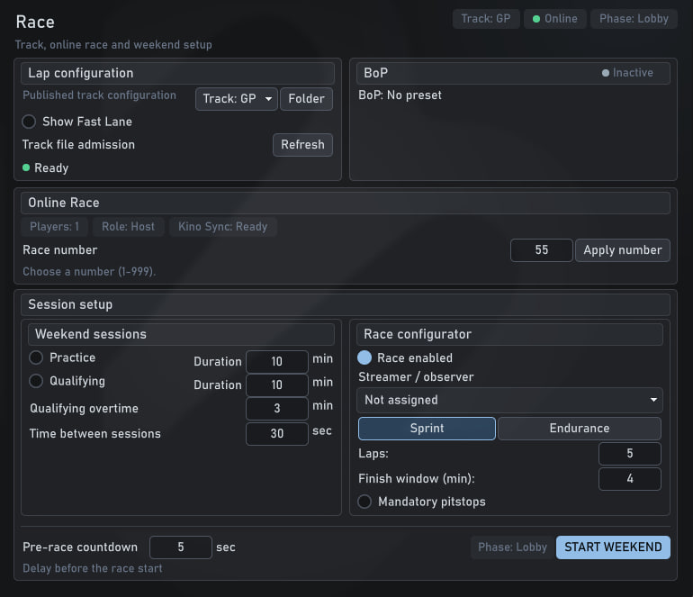
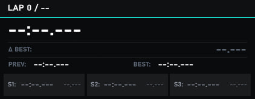

# Balance Mod for CarX Drift Racing Online


Balance Mod is a full C# gameplay and race-management overhaul for CarX Drift Racing Online.
It combines GT3 balancing, tire and fuel simulation, lap timing, live HUD systems, online race weekend logic, multiplayer sync, broadcast tools, and result export in one modular project.

This page reflects Balance Mod version **1.0.70**.

The current version of the mod is no longer just a car-balance experiment. It is now a full race-control layer built on top of CarX + Kino/KSL, with its own session flow, track logic, telemetry processing, HUD stack, and external integration pipeline.

## Key Features

### 1. GT3 Balance of Performance Presets
The mod includes a dedicated vehicle configuration system centered on GT3, with embedded car data and runtime application of:

* mass and weight distribution
* center-of-mass height
* gearbox ratios and final drive
* turbo pressure
* torque / RPM / rev limiter values
* selectable engine maps
* aerodynamic drag and downforce parameters
* per-car fuel config and startup values

The current pack contains **14 active vehicle configs**: 12 GT3-oriented presets plus VRL V8 Supercar and LMH. The GT3 selection includes BMW M4 GT3, BMW M3 GT3 Touring, Porsche 911 GT3 R (992), Ferrari 296 GT3, Lamborghini Huracan GT3 EVO2, Aston Martin Vantage GT3, Audi R8 LMS GT3, McLaren 720S GT3 EVO, Mercedes-AMG GT3, Corvette Z06 GT3, Ford Mustang GT3 and Toyota GR GT3.

### 2. Tire System
Balance Mod has its own runtime tire model layer with:

* dynamic tire temperature simulation
* wear accumulation
* grip loss from wear, temperature and pressure
* pressure calculation based on temperature
* dynamic camber influence on grip, temperature and wear
* hot/cold tire install logic
* tire stint tracking for HUD and race logic

Pit service can install fresh tires, and session transitions now automatically mount fresh tires when moving:

* from **Practice -> Qualifying**
* from **Qualifying -> Race**

### 3. Fuel System and Fuel Strategy
The fuel system is now a full gameplay subsystem instead of a simple counter:

* tank capacity, live fuel mass and fuel burn
* runtime fuel weight affecting vehicle mass
* refueling logic and pit fuel targets
* fuel starvation when fuel reaches zero
* live fuel-per-lap estimation
* historical fuel profile support
* lift-and-coast aware consumption model
* closed-throttle / decel fuel-cut style behavior

The in-game fuel UI was simplified for racing use: it now focuses on the essentials, especially approximate laps remaining.

### 4. Lap Timing and Sector Logic
The timing system includes:

* start line + sector trigger timing
* fallback lap completion by track progress if triggers fail
* live current / previous / best lap timing
* live sector timing
* invalid lap marking from track limits
* best-sector and best-lap tracking
* session-best comparisons

The fallback finish logic was improved so missed finish triggers are resolved immediately at end-of-lap progress instead of sometimes being delayed until the next lap.

### 5. Live Delta Systems
The mod includes multiple delta systems:

* spline-based lap delta against best / previous lap
* sector delta against reference lap
* live delta to leader
* broadcast-mode interval / leader-gap timing between drivers

The player-to-player broadcast gap system was additionally smoothed so values are more stable both for the host and for clients in multiplayer sessions.

### 6. Online Race Weekend System
A full online weekend controller is built into the mod:

* Lobby
* Practice
* Practice overtime
* Qualifying
* Qualifying overtime
* Inter-session transition time
* Countdown
* Race
* Finished state

Host-only session setup supports:

* enabling/disabling Practice / Qualifying / Race
* per-session duration
* overtime configuration
* time between sessions
* pre-race countdown
* race by laps or by time

### 7. Grid, Teleport and Race Start Control
The online module also handles synchronized race starts:

* random or qualifying-based grid building
* teleportation to grid / pit slots
* delayed locking on grid
* inter-session lockdown
* race-start rebasing of local lap clocks
* anti-stale and anti-desync session flow control

### 8. Race Control, Flags and Penalties
The mod includes race-control systems beyond vanilla CarX behavior:

* cut detection and off-track monitoring
* track-limits excursion evaluation
* yellow / white / blue flag logic
* host-controlled red flag
* drive-through penalties
* black-flag state
* local HUD indicators for cuts and penalties

### 9. Broadcast HUD and Race HUDs
Balance Mod has several runtime HUD layers:

* Lap Timing HUD
* Broadcast standings HUD
* Fuel status overlay
* Radar overlay
* Flag overlay
* Cut / penalty overlay
* Pit strategy and pit service overlays
* Mandatory pit-stop and pit-lane overlays
* Finish results overlay

Broadcast standings support multiple display modes:

* leader gap
* interval
* tire age

The broadcast HUD is fed by a dedicated snapshot builder instead of direct UI polling, which keeps the UI cleaner and easier to extend.

The selected UI language is also applied to the gameplay HUDs, including timing, fuel, radar, broadcast standings, race results, traction control, pit strategy and pit-service displays.




## Multiplayer Sync and Networking

The online part of the mod is built on top of **Kino.Sync / KSL** and includes custom packet transport for:

* session configuration sync
* race phase sync
* player live snapshots
* lap completion
* sector completion
* positions
* player identity / export metadata
* timing and flag-related state

The project contains a dedicated online architecture with:

* `OnlineRaceManager`
* packet router / publisher
* transport facade
* race position service
* race grid teleport service
* player delta service
* track progress service
* session handshake service

## Results, Exports and KEF Stars Integration

The mod now supports structured end-of-session export:

* qualifying results
* race finish order
* lap history
* sector times
* best laps
* penalties / cuts / off-track counts
* finish / DNF / DNS / DSQ states

It also includes **KEF Stars integration** with API client / payload builder code for:

* entry-list fetch
* session submission
* external race result pipelines

This makes the mod useful not only as gameplay logic, but also as backend infrastructure for organized community championships.

## Track and Racing-Line Support

The project includes embedded fast-lane data for **17 tracks**, used by:

* lap delta
* track progress logic
* sector fallback logic
* cut evaluation
* race-order timing services

## UI, Tuning and Dev Tools

Besides race features, the mod still includes a large amount of tuning and debugging tooling:

* Kino UI control panel
* car panel
* lap panel
* spline panel
* grid / online tools
* runtime desc editor tools
* aero tools
* final drive tuning
* tire pressure controls
* traction-control settings and keybinds
* brake-balance and engine-map keybinds
* debug visualizers
* performance sampling hooks

This makes the project usable both as a playable mod and as a live development / balancing framework.

## What Changed From Older Builds

The current project state is more focused and production-ready than older internal versions:

### Added / Expanded
* full online race weekend flow
* overtime logic
* progress-based lap-finish fallback
* fuel strategy and lift/coast-aware fuel behavior
* broadcast standings HUD
* finish results overlay
* final session JSON export
* KEF Stars integration
* smoother player gap / interval timing
* automatic fresh-tire install between sessions
* localized gameplay HUDs
* traction-control, engine-map and brake-balance controls
* dynamic camber effects on tire behavior
* assigned pit-box guidance and pit-service validation

### Simplified / Removed / Streamlined
* fuel menu was reduced to essentials
* noisy debug spam for fuel and lap-delta release builds was removed
* default instant pit / tire reset keybind clutter was reduced to a single full pitstop bind

## Tech Stack

* **Language:** C# (.NET Framework 4.7.2)
* **Engine Runtime:** Unity / CarX managed runtime
* **UI:** Kino UI, IMGUI, Unity-based HUD objects
* **Networking:** Kino.Sync
* **Serialization:** Newtonsoft.Json
* **Patch / Modding Layer:** KSL / Kino / Harmony

## Installation

1. Install **KSL**: [https://github.com/trbflxr/ksl](https://github.com/trbflxr/ksl)
2. Install **Kino**: [https://github.com/trbflxr/kino](https://github.com/trbflxr/kino)
3. Build or download `BalanceMod.ksm`
4. Place `BalanceMod.ksm` into:

```text
...\CarX Drift Racing Online\kino\mods
```

## Project Scope

Balance Mod is currently best described as:

* a GT3 balance pack
* a race weekend controller
* a telemetry and HUD system
* a multiplayer race sync layer
* a result export / championship integration backend

All of that lives inside one Unity/C# CarX mod project.

## Credits

* **Lead Developer:** [Kido](https://github.com/kido4sv)
* **Testing / Development Support:** Jeefrect, Popura, Harvok, Giozzik, Xameron, Dranser, Schnordic, stiiky

---

*This project is built for community racing, experimentation, and advanced gameplay systems inside CarX Drift Racing Online.*
